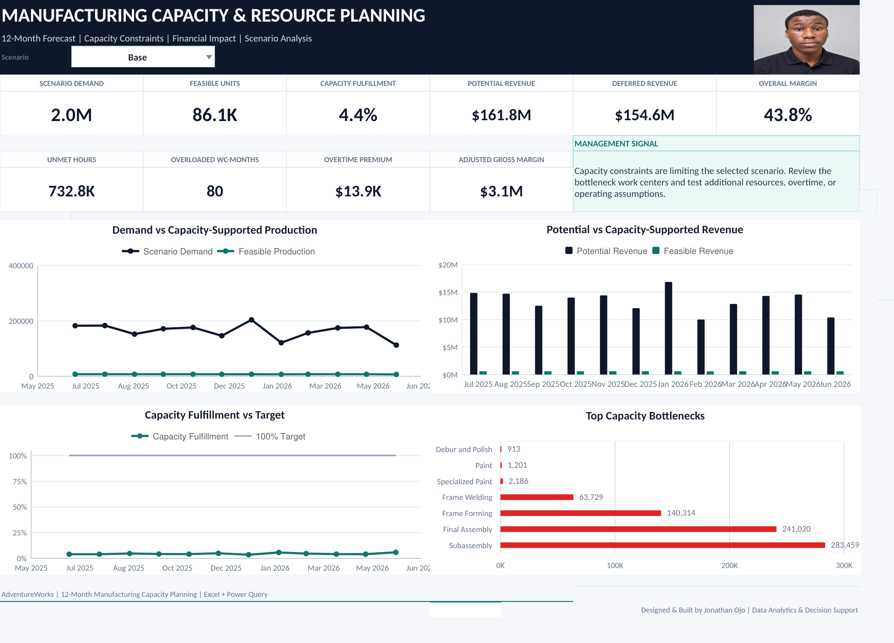

# Manufacturing Capacity Planning System

An Excel-based manufacturing capacity planning and decision-support model built with **Excel, Power Query, forecasting, scenario analysis, and dashboard reporting** using Microsoft AdventureWorks data.

## What the model does

The workbook connects:

**Demand Forecast → Workload → Capacity → Feasible Production → Financial Impact**

It helps answer questions such as:

* Can available capacity support forecast demand?
* Which work centers are becoming bottlenecks?
* How much production can realistically be fulfilled?
* What happens under Conservative, Base, and Growth scenarios?
* What is the potential financial impact of capacity constraints?

## Key Features

* 12-month demand forecasting
* Product-to-work-center workload modeling
* Manufacturing capacity and utilization analysis
* Conservative, Base, and Growth scenario testing
* Resource planning
* Bottleneck identification
* Revenue, cost, margin, and deferred-revenue estimates
* Quarterly management reporting
* Capacity heatmap
* Interactive Excel dashboard
* Manual production planning inputs
* Portable Power Query setup with embedded source data

## Dashboard

## Workbook Structure

Main user-facing sheets include:

* `Dashboard`
* `Management_Summary`
* `Capacity_Heatmap`
* `Quarterly_Summary`
* `Financial_Projection`
* `Capacity_Forecast`
* `Controls`
* `Resource_Input`
* `Production_Input`

Technical source and Power Query sheets are hidden in the public workbook.

## Data

Built using the public **Microsoft AdventureWorks OLTP** manufacturing dataset.

Key development data includes:

* 72,591 Work Orders
* 67,131 Work Order Routing records
* 504 Products
* 14 Work Centers / Locations

## Portability

The final workbook is self-contained.

AdventureWorks source data is embedded inside the workbook and connected to Power Query using internal Excel tables, so **Refresh All works without local CSV file paths**.

## Tools & Skills

Excel • Power Query • Data Modeling • Forecasting • Capacity Planning • Scenario Analysis • Financial Modeling • Dashboard Design

## Author

**Jonathan Ojo**

Portfolio: https://ojojonathanportfolio.netlify.app/
GitHub: https://github.com/Odafe16
LinkedIn: https://www.linkedin.com/in/jonathan-ojo-a34070393/

Excel • Power Query • Data Modeling • Forecasting • Capacity Planning • Scenario Analysis • Financial Modeling • Dashboard Design

Author
Jonathan Ojo

Portfolio: https://ojojonathanportfolio.netlify.app/ GitHub: https://github.com/Odafe16 LinkedIn: https://www.linkedin.com/in/jonathan-ojo-a34070393/
