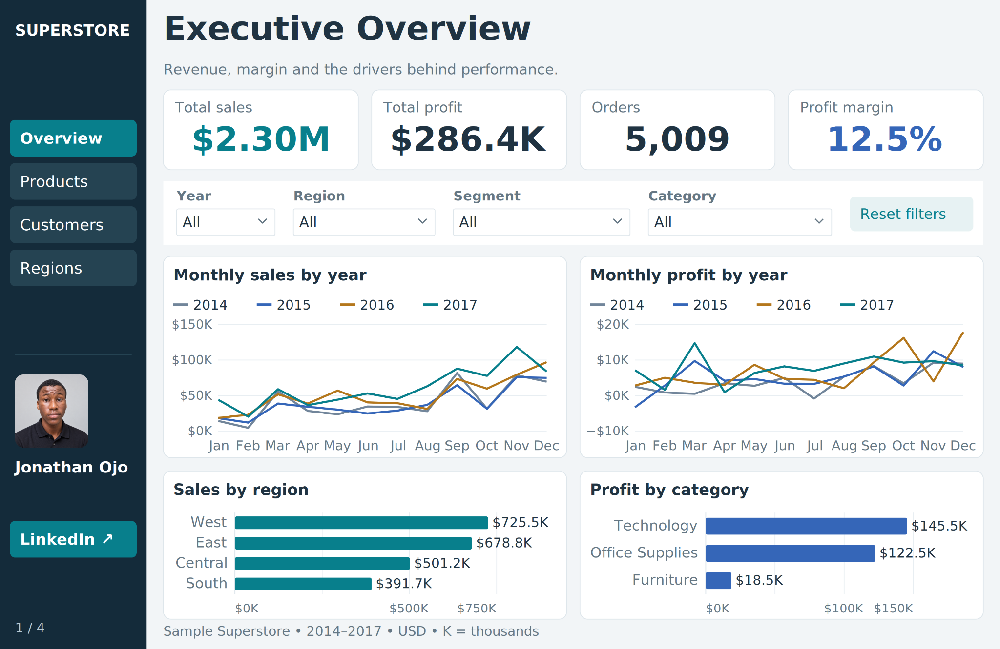
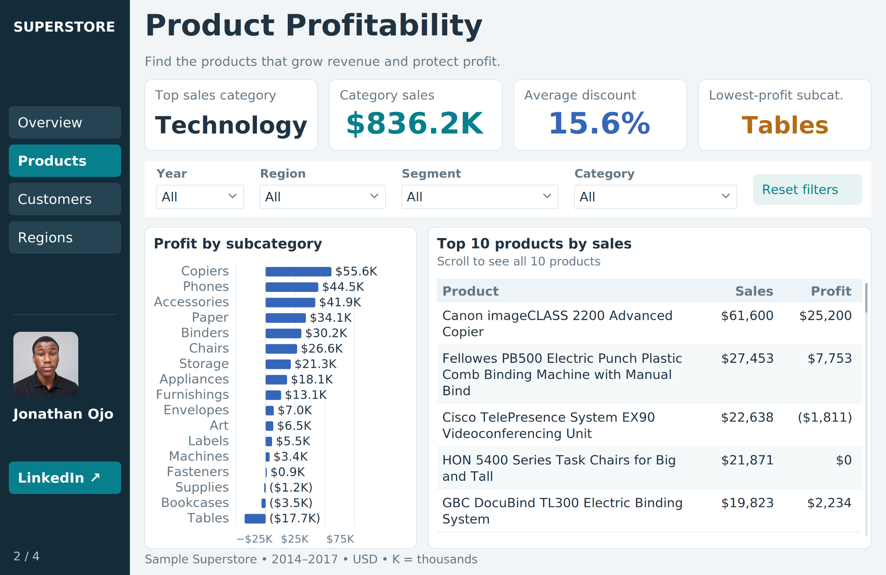
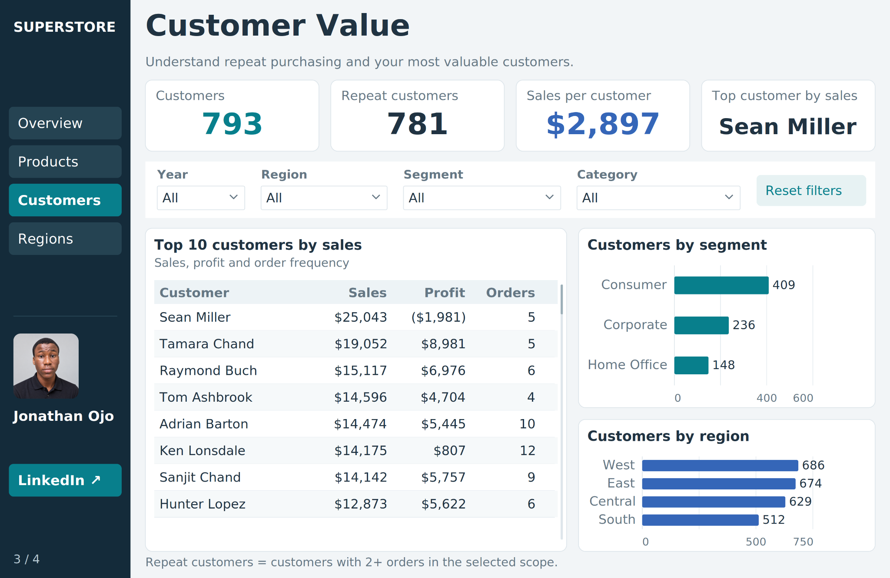
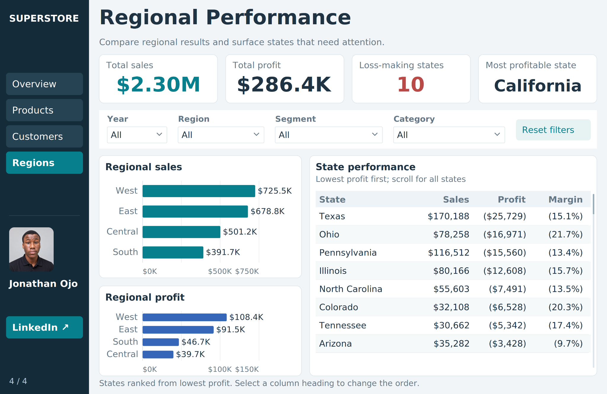

# Superstore Sales & Profitability Analysis

I wanted to understand how Superstore's sales translated into profit, which products performed well, and where losses occurred. I built a four-page Power BI report to explore those questions across products, customers, and regions.

## The report

The report uses Sample Superstore data covering 2014–2017. Monetary values are in US dollars.

| Page | Questions explored |
| --- | --- |
| Executive Overview | How do sales, profit, orders, and margin compare across time and business segments? |
| Product Profitability | Which categories and products generate revenue, and which subcategories lose money? |
| Customer Value | Who contributes the most sales, how profitable are they, and how common is repeat purchasing? |
| Regional Performance | Where are sales and profits concentrated, and which states record losses? |

Each page includes filters for year, region, segment, and category, with navigation between the four pages.

## What I noticed

Across the full dataset, sales total about **$2.30 million**, profit totals **$286.4 thousand**, and the profit margin is **12.5%** across **5,009 orders**.

Sales and profitability do not always move together. Tables record about **$17.7 thousand in losses**. Sean Miller, the customer with the highest sales, contributes **$25,043 in sales** but a **$1,981 loss**. The regional view identifies **10 loss-making states**, with Texas recording about **$25.7 thousand in losses**.

These are findings from a sample dataset. They illustrate questions a business could investigate before choosing an action; they do not establish the causes of the losses.

## Tools and features

- Microsoft Power BI
- KPI cards for sales, profit, margin, orders, and customer metrics
- Monthly comparisons, category and regional charts, and ranked tables
- Interactive slicers and page navigation

Repeat customers are defined as customers with two or more orders in the selected scope. Customer counts across regions may overlap because one customer can appear in more than one region.

## Explore the project

Download [the Power BI report](dashboard/Superstore_Analytics.pbix) and open it in Power BI Desktop. The screenshots below show the report with all filters selected. Refreshing the underlying data may require updating its source connection.

### Product Profitability

### Customer Value

### Regional Performance

## Files

- `dashboard/Superstore_Analytics.pbix`: working Power BI report
- `images/`: screenshots of the four report pages

This is an independent portfolio project using Sample Superstore data.
